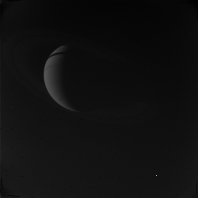

> For AI agents: the complete documentation index is available at /pds2img/llms.txt, the full documentation bundle is available at /pds2img/llms-full.txt.

# Introduction

**pds2img** reads image products from the [NASA Planetary Data System (PDS)](https://pds.nasa.gov/) and exports them as **16-bit grayscale PNG or TIFF** files. It runs in browsers and in Node.js.

## What it supports

| Standard | Label                                       | Image data                                       | Typical missions                                   |
| -------- | ------------------------------------------- | ------------------------------------------------ | -------------------------------------------------- |
| **PDS3** | `.LBL` (detached) or attached to the `.IMG` | `IMAGE` object, 8/16/32-bit integer or IEEE real | Voyager, Galileo, Cassini, Mars Exploration Rovers |
| **PDS4** | `.xml`                                      | `Array_2D_Image`, integer or IEEE 754 samples    | Mars 2020 Perseverance, InSight, OSIRIS-REx        |

See [Supported formats](/pds2img/guide/usage/formats.md) for the complete list of keywords and data types.

## How the conversion works

1. **Parse the label.** A PDS3 label is parsed into a plain object; a PDS4 label is parsed into an XML `Document`.
2. **Locate the pixels.** The library reads the image size, sample type, byte order, line prefix bytes and the byte offset of the image inside the data file.
3. **Calibrate.** Each raw sample is converted to a physical value with `raw × scale + offset`. In PDS3 products, samples equal to `INVALID_CONSTANT` or `MISSING_CONSTANT` become `NaN`.
4. **Encode.** The finite values are linearly mapped to `0…65535` and written as an uncompressed 16-bit grayscale PNG or TIFF. `NaN` pixels are written as `0`.

The output keeps the full dynamic range of the source data. A display-oriented 8-bit image would lose some of it.

## Design

The public API is a small facade:

- **Loaders** turn files, buffers or URLs into an image object: `loadPDS3Image`, `loadPDS4Image` and their `ByFile` / `ByUrl` variants.
- **Encoders** turn an image object into a file: `toPNG` and `toTIFF`.

Label parsing, binary decoding and byte-order handling are internal. The low-level classes (`PDS3Image`, `PDS4Image`) and parsers (`parseLBL`, `parseXML`) are still exported for advanced use.

## Next steps

- [Getting started](/pds2img/guide/start/getting-started.md): install the package and convert your first image.
- [Playground](/pds2img/playground.md): try it in the browser with your own files.
